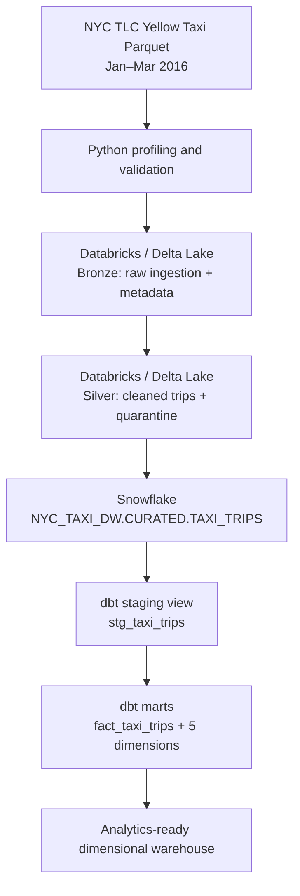
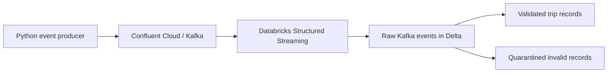

# NYC Taxi Data Platform

**A cloud data engineering project processing 34.4 million NYC Yellow Taxi trips using Databricks, Delta Lake, Kafka, Snowflake, and dbt.**

[](https://www.python.org/)
[](https://www.databricks.com/)
[](https://kafka.apache.org/)
[](https://www.snowflake.com/)
[](https://www.getdbt.com/)

## Overview

This repository documents the design and implementation of a modern data platform built on **NYC Taxi & Limousine Commission (TLC) Yellow Taxi trip data** from **January–March 2016**. It covers local data profiling, scalable batch ingestion, Silver-layer quality controls, a Kafka-based streaming prototype, Snowflake warehousing, and dimensional modeling with dbt.

The main analytics path is a **batch pipeline from Parquet to Delta Lake to Snowflake and dbt**. The **Kafka/Structured Streaming path is a separate demonstration** of incremental processing, validation, replay, and quarantine; it is not presented as a continuously operating production service.

### Results at a glance

| Metric | Recorded result |
| --- | ---: |
| Raw trips ingested into Bronze | **34,484,303** |
| Valid trips retained in Silver | **34,446,756** |
| Records sent to quarantine | **37,547** |
| Trips loaded into Snowflake | **34,446,756** |
| Deduplicated trips in dbt fact model | **34,446,753** |
| Duplicate event records removed in the fact model | **3** |
| dbt data quality tests passed | **26 / 26** |

*These figures are from the project's completed validation runs, not live metrics.*

## Architecture

### Batch analytics pipeline



### Kafka streaming prototype



The streaming implementation explores event ingestion, schema validation, checkpointing, replay, duplicate handling, and separation of valid and invalid events. **It is distinct from the historical 34.4-million-row batch load.**

## Technology stack

| Technology | Role |
| --- | --- |
| **Python, pandas, pytest** | Data profiling, quality rules, validation, and automated tests |
| **PySpark / Apache Spark** | Distributed batch transformations and streaming processing |
| **Databricks + Delta Lake** | Bronze/Silver lakehouse tables and streaming outputs |
| **Apache Kafka / Confluent Cloud** | Event transport for the streaming prototype |
| **Docker** | Local Kafka-related development tooling |
| **Snowflake** | Cloud analytical warehouse for curated trip records |
| **dbt + SQL** | Staging, dimensional marts, data lineage, and data quality tests |
| **Git / GitHub** | Version control and project documentation |

## Implementation by phase

| Phase | Scope | Status |
| --- | --- | --- |
| **0 — Profiling** | Explore raw data distributions, nulls, anomalies, and quality rules | Completed |
| **1 — Bronze** | Ingest Parquet to Delta Lake with source and ingestion metadata | Completed |
| **2 — Silver** | Validate trip records and route invalid rows to quarantine | Completed |
| **3 — Kafka** | Develop a Python producer and experiment with event streaming | Prototype developed; some experiments retained locally |
| **4 — Streaming quality** | Structured Streaming, raw/valid/quarantine tables, and recovery tests | Completed demonstration |
| **5 — Snowflake** | Transfer validated Silver data and verify the warehouse load | Completed |
| **6 — dbt** | Build staging and marts, deduplicate facts, and test data integrity | Completed |
| **7 — Airflow** | Orchestrate and schedule the pipeline | Planned |
| **8 — Power BI** | Build analytics dashboards | Planned |
| **9 — Machine Learning** | Explore predictive use cases | Planned |

## Data quality and modeling

### Bronze and Silver

- **Bronze:** preserves the raw historical trips and tracks metadata such as `source_file`, `ingestion_run_id`, `ingested_at`, `schema_version`, and `event_id`.
- **Silver:** applies validation rules to trip data and separates valid rows from a quarantine dataset for inspection.
- **Quality outcome:** 34,446,756 valid records and 37,547 quarantined records from the 34,484,303-record batch.

### Snowflake warehouse

The validated Silver dataset was loaded to **`NYC_TAXI_DW.CURATED.TAXI_TRIPS`** through a Databricks-to-Snowflake integration. Load checks covered row counts, `event_id` completeness, schema, and aggregate trip measures.

### dbt dimensional marts

The project builds an analytics-ready fact table and five dimensions:

```text
fact_taxi_trips
├── dim_date            (pickup and dropoff date keys)
├── dim_vendor          (vendor_id)
├── dim_payment_type    (payment_type)
├── dim_rate_code       (ratecode_id)
└── dim_location        (pickup and dropoff location IDs)
```

The dbt fact model uses `ROW_NUMBER()` partitioned by `EVENT_ID` to select a single row for each event. This reduced the original **34,446,756** curated rows to **34,446,753** unique fact records.

The [`dbt/models/marts/schema.yml`](dbt/models/marts/schema.yml) definitions include **26 generic data tests**:

- 13 `not_null` checks
- 6 `unique` checks
- 7 `relationships` checks between facts and dimensions

**Last recorded dbt test result: 26 passed.**

## Repository structure

```text
nyc-taxi-data-platform/
├── README.md                 # Project overview (this file)
├── dbt/
│   ├── dbt_project.yml
│   ├── packages.yml
│   └── models/
│       ├── sources.yml
│       ├── staging/
│       │   └── stg_taxi_trips.sql
│       └── marts/
│           ├── dim_date.sql
│           ├── dim_location.sql
│           ├── dim_payment_type.sql
│           ├── dim_rate_code.sql
│           ├── dim_vendor.sql
│           ├── fact_taxi_trips.sql
│           └── schema.yml
├── docs/                     # Architecture, contracts, profiling, phase notes
├── kafka/                    # Local Kafka development configuration
├── notebooks/
│   ├── bronze/
│   ├── silver/
│   ├── streaming/
│   └── snowflake/
├── src/                      # Profiling, validation, and streaming producer code
├── tests/                    # Python data quality tests
├── requirements.txt
└── .gitignore
```

## Explore the implementation

- [Bronze ingestion notebook](notebooks/bronze/01_bronze_ingestion.ipynb)
- [Silver processing notebook](notebooks/silver/02_silver_processing.ipynb)
- [Streaming reliability notebook](notebooks/streaming/04_streaming_pipeline_phase4.ipynb)
- [Snowflake integration notebook](notebooks/snowflake/phase5_snowflake_warehouse.ipynb)
- [dbt project](dbt/)
- [Architecture and technical notes](docs/)

## Getting started

Clone the repository:

```bash
git clone https://github.com/Abdelbari63/nyc-taxi-data-platform.git
cd nyc-taxi-data-platform
```

For the local Python profiling and validation utilities, create a virtual environment and install the repository requirements:

```bash
python -m venv .venv
# Activate the environment for your shell, then:
pip install -r requirements.txt
```

The original dataset is available from the [NYC TLC Trip Record Data portal](https://www.nyc.gov/site/tlc/about/tlc-trip-record-data.page). Large raw Parquet files are intentionally not stored in this repository.

**Cloud execution requires additional setup.** The Databricks notebooks depend on your own workspace, data/catalog configuration, and secret scopes. The Snowflake integration requires access to a Snowflake account with appropriate permissions. The dbt project requires a separately configured Snowflake connection profile; `profiles.yml` and private credentials are not committed.

To inspect dbt lineage and tests, start with [`dbt_project.yml`](dbt/dbt_project.yml), [`sources.yml`](dbt/models/sources.yml), and [`schema.yml`](dbt/models/marts/schema.yml). Do not run ingestion notebooks against existing tables without reviewing their write modes and target configuration.

## Engineering decisions and limitations

- **Data quality before analytics:** invalid records are quarantined rather than silently mixed with curated facts.
- **Traceability:** metadata fields connect transformed rows to the source file and ingestion run.
- **Reliable streaming experiments:** raw events, validation outcomes, and checkpoint/restart behavior are evaluated separately.
- **Warehouse correctness:** dbt adds dimensional models and key-integrity tests after the Silver-to-Snowflake load.
- **Current scope:** Airflow orchestration, dashboards, and ML are planned extensions, not implemented features in this repository.

## Author

**Abdelbari BENOUARRAK** — Data Engineering portfolio project
GitHub: [@Abdelbari63](https://github.com/Abdelbari63)

---

*Dataset: NYC Taxi & Limousine Commission (TLC) public Yellow Taxi trip records. Project is independently developed for learning and portfolio demonstration.*
